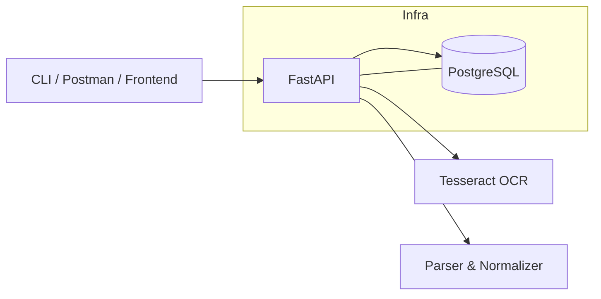
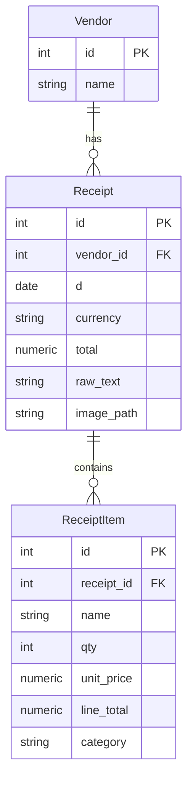

# Receipt OCR & Analytics Platform (v1)
[](#)
[](#)
[](#)

Production-grade API to parse receipt images into structured data and expose analytics (spend, categories, trends).

- **Stack:** FastAPI + SQLAlchemy 2.0 + Alembic + PostgreSQL + Docker Compose + Tesseract (via `pytesseract`)
- **Features:** Upload receipt image → OCR → parse → store; analytics endpoints (summary, by-vendor, by-keyword category)
- **Quality:** CI (pytest), Makefile, Postman collection, ASCII-safe docs
- **Live Docs:** `http://localhost:8000/docs` (after launch)

---

## Architecture (Mermaid)


---

## Domain Model


---

## Quickstart
```bash
# 0) Prepare env
cp backend/.env.example backend/.env

# 1) Run stack
docker compose -f infra/docker-compose.yml up -d --build

# 2) Init DB
docker compose -f infra/docker-compose.yml exec api alembic upgrade head

# 3) Seed demo data
docker compose -f infra/docker-compose.yml exec api python -m app.seed.seed_demo

# 4) Demo: Upload sample receipt image
curl -F "file=@docs/samples/receipt1.png" http://localhost:8000/api/v1/receipts/upload

# 5) Analytics
curl "http://localhost:8000/api/v1/analytics/summary"
curl "http://localhost:8000/api/v1/analytics/by-vendor"
curl "http://localhost:8000/api/v1/analytics/by-category"
```

OpenAPI: `http://localhost:8000/docs`

---

## API Overview
- `GET /health` → service status
- `POST /api/v1/receipts/upload` (multipart form-data: `file`) → OCR + parse + persist
- `GET /api/v1/receipts/{id}` → receipt with items
- `GET /api/v1/analytics/summary?from=YYYY-MM-DD&to=YYYY-MM-DD` → total spend, receipts count, avg per receipt
- `GET /api/v1/analytics/by-vendor` → spend by vendor
- `GET /api/v1/analytics/by-category` → spend by keyword category (coffee/bakery/deli/produce/other)

See `docs/postman_collection.json` for ready-to-run requests.

---

## Demo Preview
> Add these files into `docs/screenshots/` and they will appear here on GitHub.


---

## Roadmap
- v1 (this): Tesseract OCR + heuristic parser + analytics endpoints
- v2: Layout-aware parsing (lines/columns), ML-based item classification, currency detection, VAT parsing
- v3: Async OCR queue (Celery + Redis), S3 uploads, dashboard

---

## License
MIT
